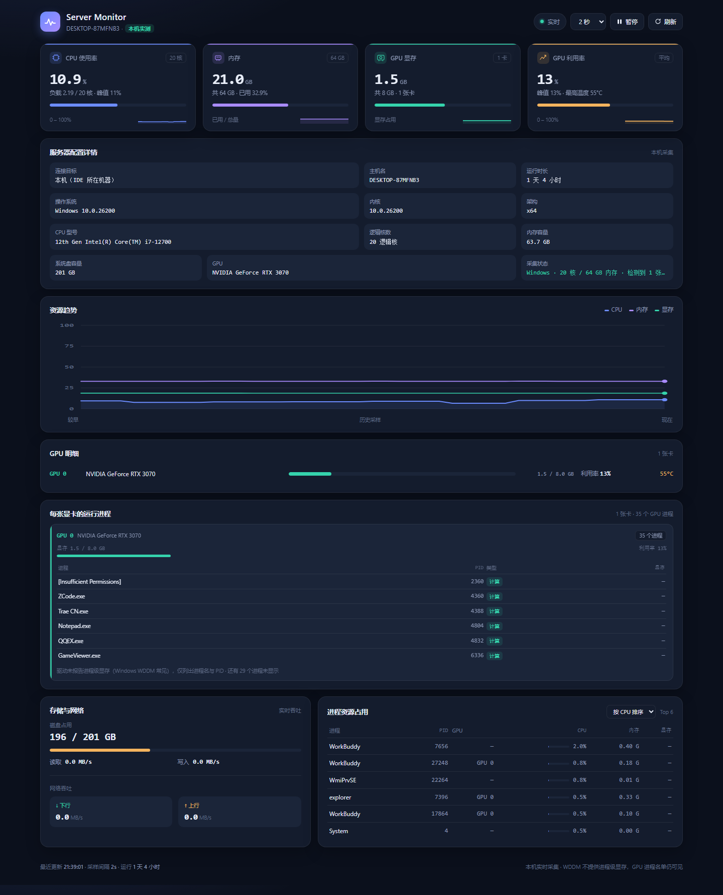
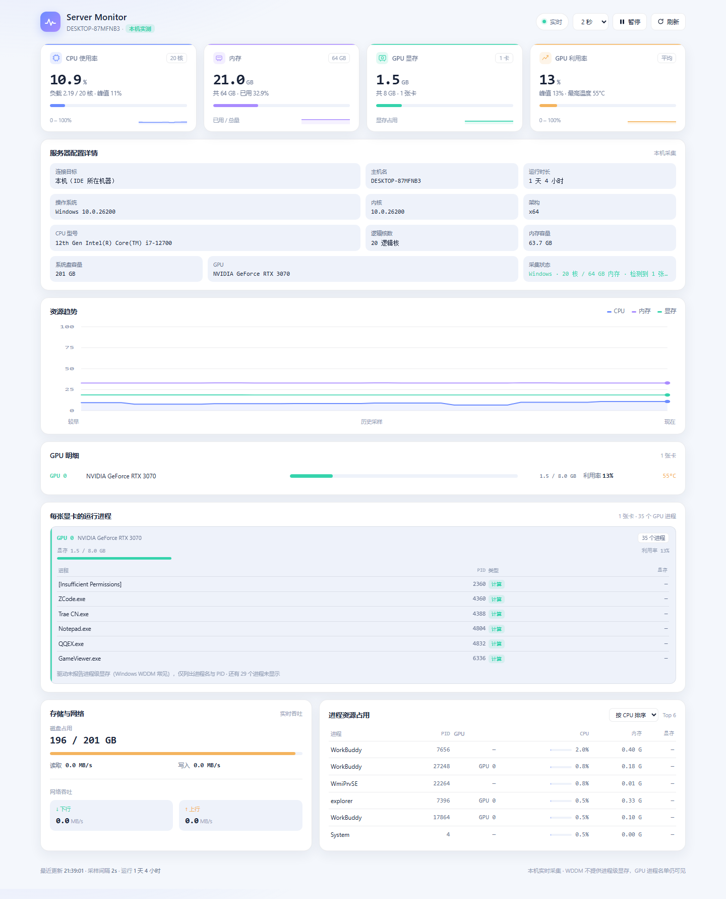
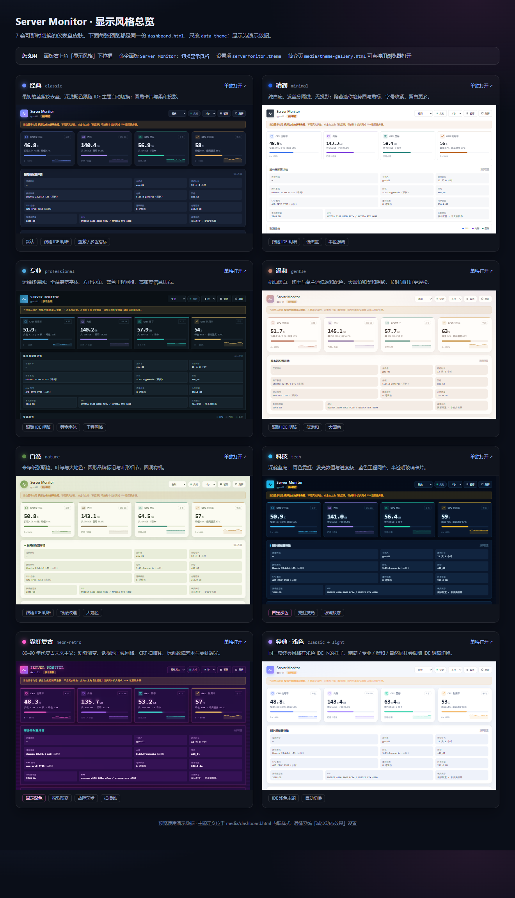

# Server Monitor

[简体中文](README.md) · **English**

Server Monitor is a resource monitoring extension for VS Code and Trae CN. It brings CPU, memory, GPU VRAM and the processes running on each GPU, disk, network and server specifications together into one live dashboard — no more switching to a terminal to run `top`, `nvidia-smi` or `df`. The UI is a built-in Webview with all CSS/JS inlined, no CDN, automatic light/dark theme support and full offline capability. A single TypeScript codebase is packaged into one `.vsix` that installs on both editors. Where the data comes from is shown below.

| Data source | What it reads |
| --- | --- |
| `local` (default) | The machine running the IDE; Windows and Linux are both supported |
| `ssh` | A remote Linux server, collected over the system OpenSSH client |
| `demo` | Simulated data, for previewing the UI only |

Current version `0.6.0`. Compatibility baseline: VS Code 1.80 public API (`engines.vscode: ^1.80.0`), pure TypeScript, no runtime dependencies, no native binaries.

---

## Screenshots

Rendered from a real `local` capture of a Windows workstation (i7-12700 / 20 cores / RTX 3070). The dashboard follows the IDE theme automatically. The UI text in the screenshots is Chinese.



<details>
<summary>Light theme (click to expand)</summary>



</details>

From top to bottom: four metric cards, server specifications, resource trends, GPU details, per-GPU processes, storage & network, and the process ranking.

### Display themes

Seven built-in themes, switchable instantly from the dropdown in the top-right corner of the panel — no reload needed. The same setting can be changed through `Server Monitor: 切换显示风格` in the Command Palette or via `serverMonitor.theme`. Themes only change CSS; data collection and refresh are unaffected.

<details>
<summary>All seven themes side by side (click to expand)</summary>



</details>

| Theme | `serverMonitor.theme` | Character |
| --- | --- | --- |
| Classic | `classic` (default) | Blue-violet dashboard, follows the IDE light/dark theme |
| Minimal | `minimal` | Pure white, hairline rules, no shadows; sparklines and badges hidden |
| Professional | `professional` | Monospaced throughout, square corners, engineering grid, ops-console density |
| Gentle | `gentle` | Warm cream, clay and muted Morandi tones, large radii, soft shadows |
| Nature | `nature` | Moss-green paper grain, leaf green and earth tones, organic shapes |
| Tech | `tech` | Deep indigo, cyan neon glow, glass cards, blue engineering grid |
| Neon Retro | `neon-retro` | 80s/90s retro-futurism: pink-purple gradient, perspective horizon grid, CRT scanlines, glitch title and neon glow |

The first five follow the IDE light/dark theme; `tech` and `neon-retro` are intentionally fixed dark. Open `media/theme-gallery.html` in a browser for a side-by-side preview, or `media/dashboard.html?theme=tech` for a single theme (`&scheme=light` reproduces a light IDE). Preview pages use demo data. Animations respect the system "reduce motion" setting.

---

## 1. Installation

Build artifact: `./server-monitor.vsix`

### First install

- **Trae CN (primary)**: Extensions panel (`Ctrl+Shift+X`) → `···` at the **top-left** of the marketplace → "Install from VSIX"; or simply drag the `.vsix` into the Extensions panel. Official docs: <https://docs.trae.cn/ide_manage-extensions>
- **VS Code**: `code --install-extension <absolute path to vsix>`, or "Install from VSIX" in the Extensions panel.
- **Fully quit and restart the IDE** afterwards (the extension activates on `onStartupFinished`; reloading the window alone is sometimes not enough).

> Not finding it in the marketplace is expected: third-party IDEs cannot connect to the VS Code Marketplace directly, so installing a local VSIX is the official path.

### Redeploying after a code change

Source changes are **not** picked up by an installed extension — repackage and reinstall:

1. Run `npm run compile && npm run package` and confirm the timestamp of `server-monitor.vsix` changed.
2. Uninstall the old version, then install the new VSIX as above. If a CLI is available: `trae --install-extension <absolute path to vsix> --force` (neither `trae` nor `trae-cn` is on PATH on this machine, so use the GUI).
3. Restart the IDE and run `Server Monitor: 显示宿主环境信息` to verify the data source and target.

For development: open the project folder in VS Code and press `F5`. Trae CN is mainly for installing the finished build.

---

## 2. Commands and settings

Open the Command Palette (`Ctrl+Shift+P`) and type `Server Monitor`. Command titles are currently in Chinese, matching what the palette shows:

| Command | Description |
| --- | --- |
| `Server Monitor: 打开监控面板` | Open the dashboard (same as clicking the status bar item) |
| `Server Monitor: 暂停 / 继续刷新` | Freeze or resume sampling |
| `Server Monitor: 立即刷新` | Fetch one sample immediately |
| `Server Monitor: 切换数据源` | Switch between local / SSH / demo |
| `Server Monitor: 连接远程服务器（SSH）` | Pick a target from `~/.ssh/config` aliases, a detected session, or manual input |
| `Server Monitor: 跟随当前终端的 SSH 会话` | Detect an ssh process in the integrated terminal and follow it |
| `Server Monitor: 显示宿主环境信息` | Print data source, SSH status, server specs and collector status for troubleshooting |
| `Server Monitor: 切换显示风格` | Pick one of the seven dashboard themes; same result as the panel dropdown |

Search for `serverMonitor` in Settings:

| Setting | Default | Description |
| --- | --- | --- |
| `serverMonitor.theme` | `classic` | Display theme: `classic` / `minimal` / `professional` / `gentle` / `nature` / `tech` / `neon-retro` |
| `serverMonitor.dataSource` | `local` | `local` / `ssh` / `demo` |
| `serverMonitor.sshHost` | empty | `user@host` or a `~/.ssh/config` alias; **never put a password here** |
| `serverMonitor.sshArgs` | empty | Extra ssh arguments, e.g. `-p 2222 -i C:/keys/id_ed25519`; use a config alias for paths with spaces |
| `serverMonitor.sshTimeoutMs` | `12000` | Timeout for one SSH collection, in milliseconds |
| `serverMonitor.sshAutoDetect` | `true` | Detect ssh sessions in the integrated terminal and follow them |
| `serverMonitor.host` | empty | Display name in the panel header; empty falls back to the SSH target / machine name / `gpu-01` |
| `serverMonitor.refreshIntervalMs` | `2000` | Sampling interval: `1000` / `2000` / `5000` / `10000` (SSH enforces a 1500 ms minimum) |
| `serverMonitor.historyLength` | `60` | Number of samples kept in the trend chart |

Pause, refresh, change the interval, switch the data source and switch the display theme are also available directly on the panel.

---

## 3. Local mode (`local`)

`src/localSource.ts` dispatches on `os.platform()` and uses only Node built-ins plus commands shipped with the OS. **It reads the machine the IDE runs on** and never connects to a remote host:

| Metric | Windows | Linux |
| --- | --- | --- |
| CPU / per core | `os.cpus()` deltas | same |
| Memory | `os.totalmem() - os.freemem()` | `/proc/meminfo` (`MemAvailable`) |
| GPU VRAM / utilization / temperature | `nvidia-smi` | same |
| Disk / network / processes | PowerShell CIM counters | `/proc/diskstats`, `/proc/net/dev`, `df`, `ps` |
| Per-GPU process list | Name + PID (VRAM shown as "—") | Name + PID + VRAM + type |
| Per-process VRAM | ❌ WDDM returns `[N/A]` | ✅ `nvidia-smi --query-compute-apps` |

Notes:

- **Running the IDE on Windows while watching a remote Linux server will never give remote data via `local`** — set `dataSource` to `ssh`. With VS Code Remote-SSH opening a remote workspace, `extensionKind: ["workspace","ui"]` makes the extension run on the remote side, so `local` then reads that Linux machine (Remote support in Trae CN depends on its version and is not guaranteed).
- Windows WDDM does not expose per-process VRAM; the UI honestly shows "—" with the reason instead of faking a zero. Total GPU VRAM is accurate.
- Collectors implement the `MetricsSource` interface in `src/metrics.ts`: async background refresh plus a cached snapshot, with a synchronous `next()`. `LocalSource`, `SshSource` and `DemoSource` are provided; adding another source needs no UI or message-protocol changes.
- Switching the data source clears the trend history so real and simulated values never mix in one line.

---

## 4. SSH remote mode

Prerequisites: ① the system `ssh` client is on PATH and key-based authentication (or ssh-agent) works — the extension uses `BatchMode=yes` and never prompts for a password; ② you have connected once manually so the host key is in `known_hosts`; ③ the server is Linux with `/proc`, `df`, `ps`, `uname` and similar basics.

Either run `ssh user@server` in the **integrated terminal** (auto-follow is on by default), or run `Server Monitor: 连接远程服务器（SSH）` and choose a target manually. Once the target is known, the extension opens its own ssh connection to run the collection script (the VS Code 1.80 public API cannot read terminal input), so **whether the terminal session is logged in does not affect data collection** — it only helps identify the target. Credentials come solely from the local SSH configuration; the extension never accepts a password.

---

## 5. Troubleshooting

- **Stuck on demo data**: make sure you opened the in-IDE Server Monitor panel, not the `media/dashboard.html` preview page (that page runs standalone and always shows simulated data). Then check whether `dataSource` is set to `demo` and whether an old VSIX is installed without a restart.
- **SSH fails**: the banner at the top of the panel shows the reason in Chinese. For auth failures check `~/.ssh/config` / ssh-agent; for host-key failures connect manually once; for timeouts raise `sshTimeoutMs`.
- **Numbers look wrong**: `Server Monitor: 显示宿主环境信息` prints `dataSource`, `sshHost`, remote hostname / OS / CPU, and the `gpu processes` count to confirm the collector is active.
- **Linux collection has not been verified on a real remote machine**: parsers, script syntax and a local POSIX `sh` run are all tested. On your first connection, cross-check the values against `free -h`, `nvidia-smi` and `nproc`.

---

## 6. Scripts

```bash
npm install            # first run
npm run typecheck      # type check only
npm test               # compile + regression tests (includes one real Windows capture)
npm run compile        # compile to out/
npm run package        # produce server-monitor.vsix
```

`media/dashboard.html` can be opened directly in a browser to preview the UI (it plays simulated data automatically). Before publishing to a marketplace, replace `publisher`, `repository.url` and the LICENSE holder.
