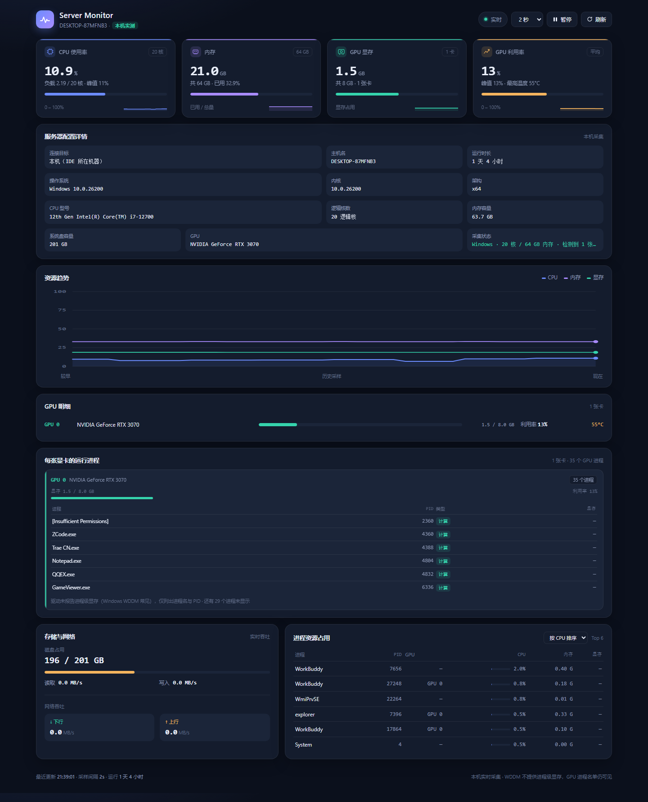
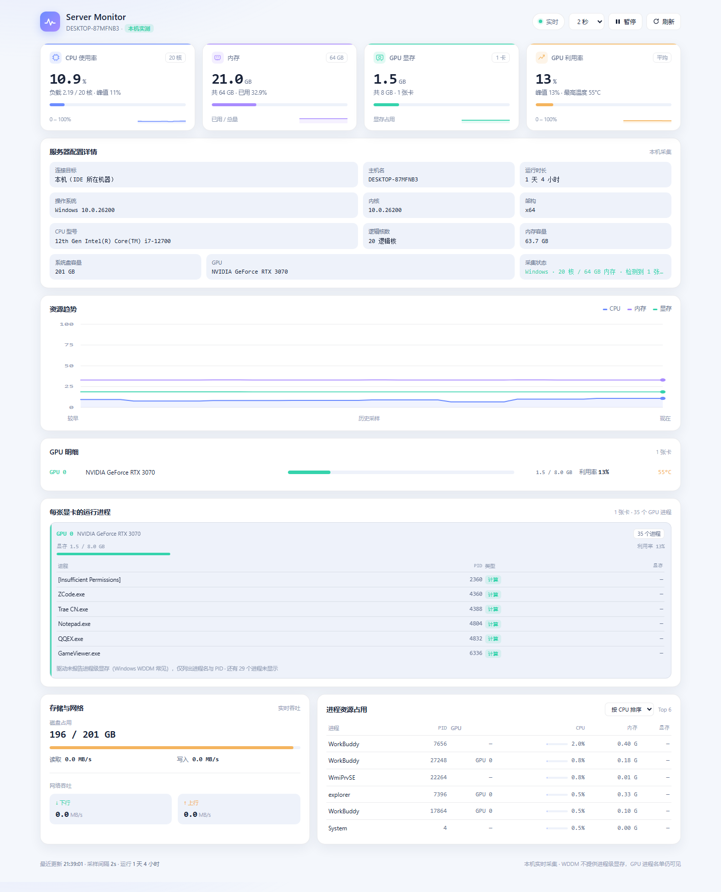

# Server Monitor

Server Monitor 是 VS Code / Trae CN 上的服务器资源监控插件：把 CPU、内存、GPU 显存与每张显卡上运行的进程、磁盘、网络和服务器配置详情集中到一张实时仪表盘里，不用再开终端反复敲 `top`、`nvidia-smi`、`df`。界面是内置 Webview，CSS/JS 全内联、零 CDN、明暗主题自适应、离线可用；一份 TypeScript 源码打成一个 `.vsix`，两端都能装。数据来自本机还是远程服务器，见下表。

| 数据源 | 读到的是谁 |
| --- | --- |
| `local`（默认） | IDE 运行所在的那台机器，Windows / Linux 都支持 |
| `ssh` | 远程 Linux 服务器，走系统 OpenSSH 采集 |
| `demo` | 模拟数据，仅用于界面预览 |

当前版本 `0.5.0`。兼容基线：VS Code 1.80 公开 API（`engines.vscode: ^1.80.0`）、纯 TypeScript、无运行时依赖、无原生二进制。

---

## 运行效果

仪表盘界面渲染图，数据来自 `local` 模式对一台 Windows 开发机的真实采集快照（i7-12700 / 20 核 / RTX 3070）；深浅主题随 IDE 自动切换。



<details>
<summary>浅色主题（点击展开）</summary>



</details>

从上到下依次为 4 张指标卡、服务器配置详情、资源趋势、GPU 明细、每张显卡的运行进程、存储与网络和进程排行。

---

## 一、部署

产物路径：`D:\Desktop\workplace\me\app\server-monitor\server-monitor.vsix`

### 首次安装

- **Trae CN（主路径）**：扩展面板（`Ctrl+Shift+X`）→ 扩展市场**左上角** `···` → 「从 VSIX 安装」，选中文件；也可直接把 `.vsix` 拖进扩展面板。官方文档：<https://docs.trae.cn/ide_manage-extensions>
- **VS Code**：`code --install-extension <vsix 绝对路径>`，或扩展面板「从 VSIX 安装」。
- 装完**完全退出并重启 IDE**（插件在 `onStartupFinished` 激活，只重载窗口有时不生效）。

> 扩展市场里搜不到本插件是正常的，第三方 IDE 受协议限制不能直连 VS Code 市场，本地 vsix 导入才是官方路径。

### 改完代码重新部署

源码改动**不会**自动同步到已安装的扩展，必须重新打包 + 覆盖安装：

1. 工程目录执行 `npm run compile && npm run package`，确认 `server-monitor.vsix` 修改时间变新。
2. 先卸载旧版，再按上面的方式安装新 vsix；命令行工具可用时可执行 `trae --install-extension <vsix 绝对路径> --force`（本机 PATH 里没有 `trae` / `trae-cn`，请用图形界面）。
3. 重启 IDE，用 `Server Monitor: 显示宿主环境信息` 核对数据源与目标。

开发调试：VS Code 打开工程文件夹按 `F5`；Trae CN 主要用来装成品。

---

## 二、命令与配置

命令面板 `Ctrl+Shift+P` 输入 `Server Monitor` 即可看到全部命令：

| 命令 | 作用 |
| --- | --- |
| `Server Monitor: 打开监控面板` | 打开仪表盘（点右下角状态栏速览同效） |
| `Server Monitor: 暂停 / 继续刷新` | 冻结或恢复采样 |
| `Server Monitor: 立即刷新` | 立刻取一次数据 |
| `Server Monitor: 切换数据源` | 本机实测 / SSH / 演示数据 |
| `Server Monitor: 连接远程服务器（SSH）` | 从 `~/.ssh/config` 别名、检测到的会话或手工输入里选目标 |
| `Server Monitor: 跟随当前终端的 SSH 会话` | 立即检测集成终端里的 ssh 进程并切换 |
| `Server Monitor: 显示宿主环境信息` | 输出数据源、SSH 状态、服务器配置与采集状态，用于排查 |

配置在设置里搜 `serverMonitor`：

| 配置项 | 默认值 | 说明 |
| --- | --- | --- |
| `serverMonitor.dataSource` | `local` | `local` / `ssh` / `demo` |
| `serverMonitor.sshHost` | 空 | `user@host` 或 `~/.ssh/config` 别名，**不要写密码** |
| `serverMonitor.sshArgs` | 空 | 附加 ssh 参数，如 `-p 2222 -i C:/keys/id_ed25519`；含空格路径请改用 config 别名 |
| `serverMonitor.sshTimeoutMs` | `12000` | 单次 SSH 采集超时（毫秒） |
| `serverMonitor.sshAutoDetect` | `true` | 自动识别集成终端里的 ssh 会话并切换 |
| `serverMonitor.host` | 空 | 面板顶部显示名称，留空时分别显示 SSH 目标 / 计算机名 / `gpu-01` |
| `serverMonitor.refreshIntervalMs` | `2000` | 采样间隔，可选 `1000` / `2000` / `5000` / `10000`（SSH 内部最小 1500 ms） |
| `serverMonitor.historyLength` | `60` | 趋势图保留的采样点数 |

面板上还可直接暂停 / 刷新 / 切采样间隔 / 切数据源。

---

## 三、本机模式（`local`）说明

`src/localSource.ts` 按 `os.platform()` 分派，全部使用 Node 内置模块 + 系统自带命令，**采的是 IDE 运行所在的那台机器**，不连接任何远程主机：

| 指标 | Windows | Linux |
| --- | --- | --- |
| CPU / 每核 | `os.cpus()` 差分 | 同左 |
| 内存 | `os.totalmem() - os.freemem()` | `/proc/meminfo`（`MemAvailable`） |
| GPU 显存 / 利用率 / 温度 | `nvidia-smi` | 同左 |
| 磁盘 / 网络 / 进程 | PowerShell CIM 计数器 | `/proc/diskstats`、`/proc/net/dev`、`df`、`ps` |
| 每卡 GPU 进程名单 | 进程名 + PID（显存显示「—」） | 进程名 + PID + 显存 + 类型 |
| 进程级显存 | ❌ WDDM 返回 `[N/A]` | ✅ `nvidia-smi --query-compute-apps` |

要点：

- **Windows 上开 IDE 看远程 Linux 服务器，`local` 永远只能给本机数据**，必须把 `dataSource` 设为 `ssh`。若用 VS Code Remote-SSH 直接打开远程工作区，清单里的 `extensionKind: ["workspace","ui"]` 会让扩展优先跑在远端，此时 `local` 采到的就是那台 Linux 机器（Trae CN 是否支持 Remote 取决于版本，不保证）。
- Windows WDDM 拿不到进程级显存，界面如实显示「—」并注明原因，不用 0 冒充；GPU 总显存准确。
- 采集层抽象为 `src/metrics.ts` 的 `MetricsSource` 接口，统一「后台异步刷新 + 快照缓存」、`next()` 同步返回。现有实现 `LocalSource` / `SshSource` / `DemoSource`，新增数据源时 UI 和消息协议都不用改。
- 切换数据源会清空历史趋势，避免真假数据混在一条线里。

---

## 四、SSH 远程模式（简述）

前提：① 系统 `ssh` 在 PATH 中且已配好免密（密钥或 ssh-agent，插件用 `BatchMode=yes` 永不弹密码框）；② 先手动 ssh 一次确认主机指纹写入 `known_hosts`；③ 服务器为 Linux 且有 `/proc`、`df`、`ps`、`uname` 等基础命令。

用法二选一：在**集成终端**里 `ssh user@server`（自动跟随，默认开启），或执行 `Server Monitor: 连接远程服务器（SSH）` 手动选目标。插件识别目标后用系统 ssh 单独开一条连接执行采集脚本（VS Code 1.80 公开 API 读不到终端输入内容），所以**终端是否登录不影响取数**，只是用来自动认出目标。凭据只用本地 SSH 配置，插件不接收密码。

---

## 五、常见问题

- **一直是演示数据**：先确认打开的是 IDE 内的 Server Monitor 面板，而不是 `media/dashboard.html` 预览页（后者脱离插件运行，永远是假数据）；再检查 `dataSource` 是否被设成 `demo`，以及是否装了旧版 vsix 且未重启。
- **SSH 连不上**：面板顶部横幅给出中文原因；认证失败查 `~/.ssh/config` / ssh-agent，主机密钥校验失败先手动连一次，超时可调大 `sshTimeoutMs`。
- **数据看着不对**：`Server Monitor: 显示宿主环境信息` 会打印 `dataSource`、`sshHost`、远端 hostname / OS / CPU，`gpu processes` 数量可确认采集层是否生效。
- **Linux 采集未在真机端到端实跑**：解析逻辑、脚本语法与本机 POSIX sh 实跑均已验证，第一次连真机请对照 `free -h`、`nvidia-smi`、`nproc` 核一下读数。

---

## 六、工程脚本

```bash
npm install            # 首次
npm run typecheck      # 类型检查
npm test               # 编译 + 回归测试（含一次 Windows 本机真实采集）
npm run compile        # 编译到 out/
npm run package        # 产出 server-monitor.vsix
```

`media/dashboard.html` 可单独用浏览器打开看界面（自动播放演示数据）。发布到扩展市场前还需替换 `publisher`、`repository.url` 和 `LICENSE` 署名。
